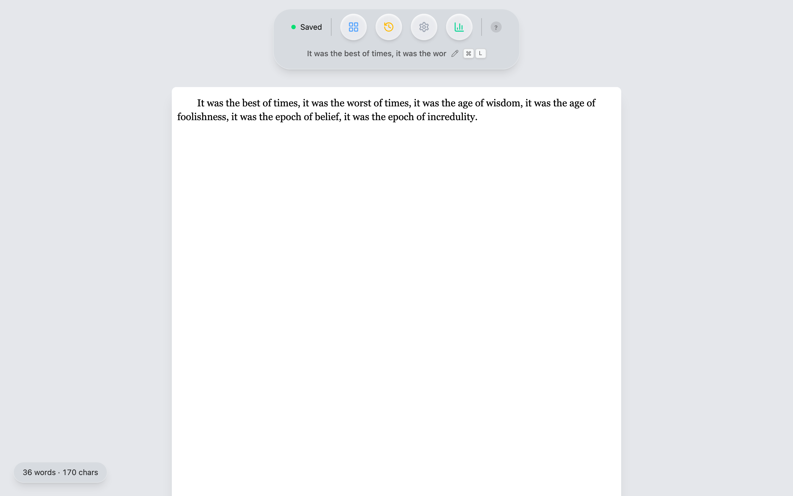
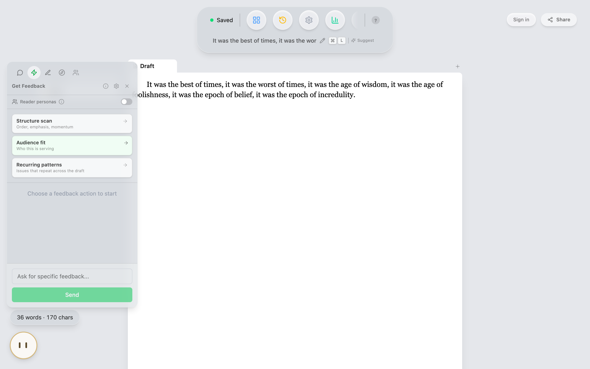
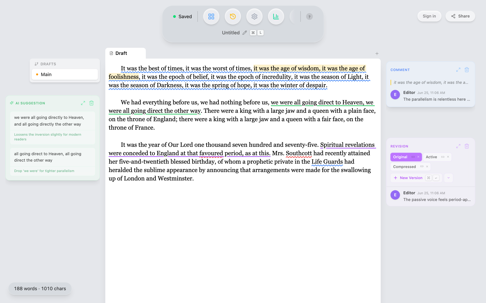
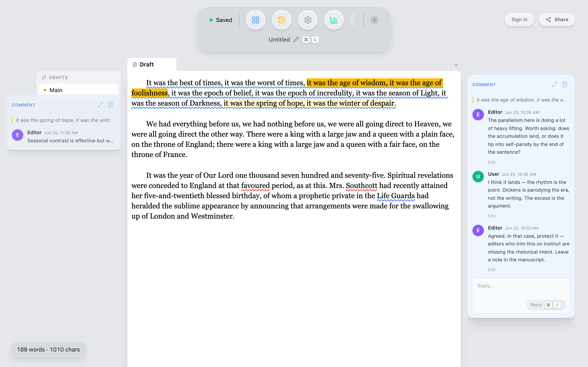
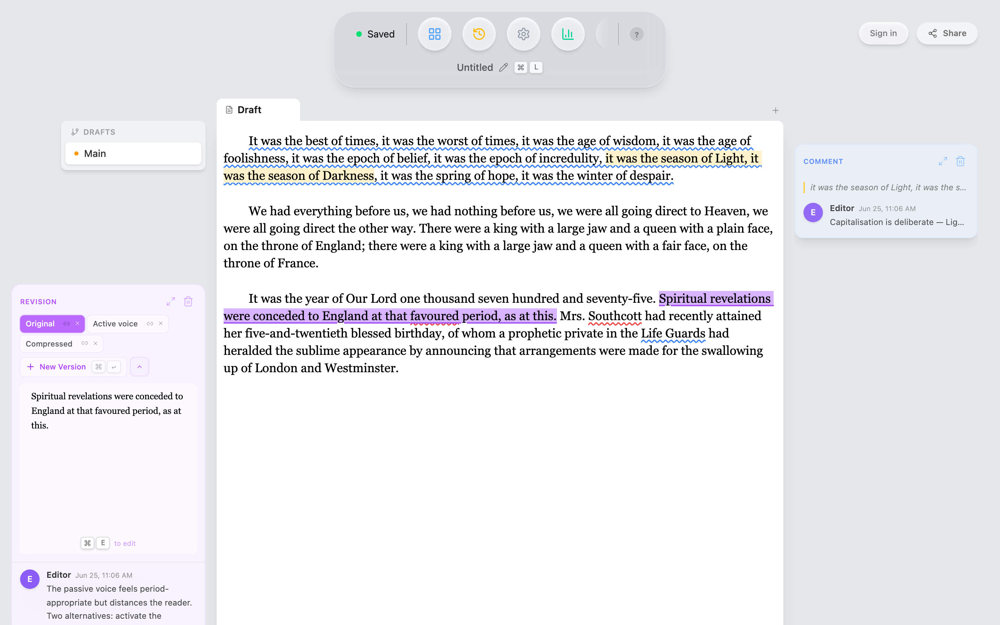
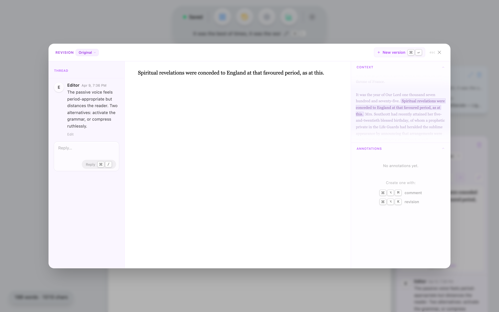
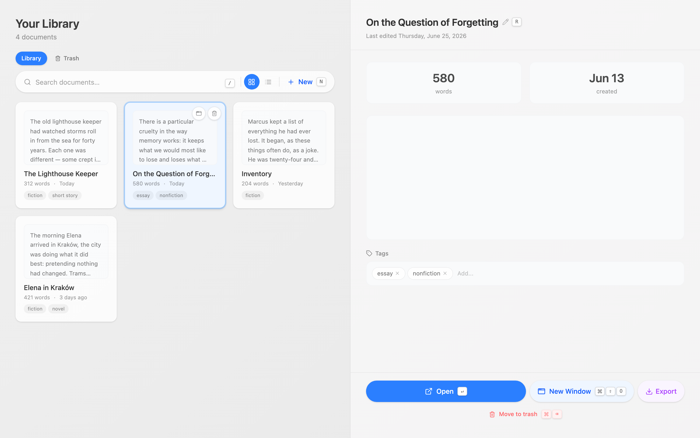
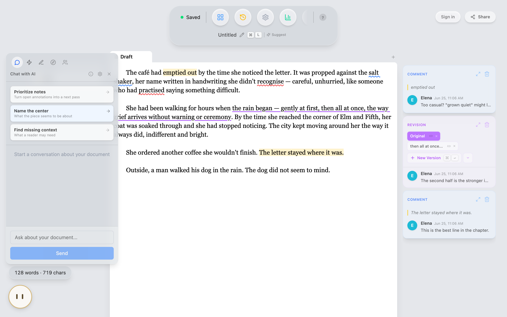

# Screenshot gallery

These are committed demo captures from
[`packages/desktop/screenshots`](packages/desktop/screenshots). Refresh them from
the repository root with `bun run desktop:screenshots`, then inspect the image
diff before committing. CI does not refresh this gallery on every push.

The capture script seeds mock Tauri data. These images illustrate the app; they
do not verify native persistence. For release-note images, use the
[changelog guide](docs/changelog.md). For regression baselines, use
[visual regression and CI](docs/visual-regression.md).

## Editor

*The focused writing environment: document card, status bar, and the collapsed AI sidebar pill.*

## AI feedback

*The Feedback panel with Structure scan, Audience fit, Recurring patterns, and the reader-persona toggle.*

## Annotations

*Comments, suggestions, and revisions floating beside the text in their resting state.*

## Comment thread

*An active comment card with a full back-and-forth thread and reply input. The yellow highlight marks the annotated text.*

## Inline revision editor

*A revision card with version pills and the inline nested CodeMirror editor open. The purple highlight marks the range.*

## Revision modal

*The full-screen revision modal for editing alternative text without distraction.*

## Document library

*The document library: grid view with document cards and the preview panel.*

## Editor with AI sidebar

*Comments and a revision beside the draft, with contextual starting points in the Chat sidebar.*

