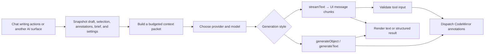

# Sidebar and AI request pipeline

Quillium's AI features run in the desktop client using the writer's selected
provider and credentials. There is no Quillium inference server in the request
path. Prompts are assembled locally and sent directly to the selected provider,
ChatGPT connection, or OpenAI-compatible endpoint.

The sidebar hosts both local writing panels and AI panels. Separate Chat, Feedback,
and Revise panels are the default. Settings → Advanced → AI → AI panel layout
offers One assistant as an explicit opt-in to unified Chat. The saved setting
is `aiSidebarLayout: "separate" | "combined"`; missing or invalid values use
`"separate"`, including on upgrades. Both layouts use the current editorial pipeline
and preserve saved conversation IDs and messages.

It is the main AI entry point, but the same provider, context, and
cancellation infrastructure also powers AutoAI, document-context generation,
the dictionary assistant, annotation-thread suggestions, title suggestions, and
the writing characterizer.

## Request pipeline



For sidebar conversations, `createAiChat()` creates an AI SDK `Chat` with a
custom transport. At send time the transport snapshots the current document,
tab, draft, nested revision-version path, selection and mapped range, open
annotations, active annotation, writer brief, saved decisions, editorial
preferences, and provider settings. `editorialPolicy.ts` compiles the shared author-first
policy, task recipe, and allowed action types. `clientStreams.ts` prepends the
context packet as a user message and calls `streamText()`.

Chat treats dissatisfaction with wording as a request for diagnosis, not permission
to supply replacement prose. Under Author-first, a diagnosis does not authorize a
rewrite; the writer must explicitly request wording or invoke a permitted rewrite
task. Feedback remains diagnostic for every stance and voice setting, including
selected passages: neither its chat text nor its comment fields should contain
replacement prose. The Suggest revisions action enables replacement proposals for that turn. These are model
instructions. Tool permissions separately enforce which annotations can be created.

Text chunks update the panel through `@ai-sdk/svelte`. Tool calls are validated
with Zod, checked against the turn's permissions and captured editor identity,
mapped selection, and target text, then routed by `chatFactory.ts` to the
annotation commands. A
stale, out-of-scope, forbidden, or missing target is skipped with a warning.

### Core files

Unqualified AI filenames below live in `packages/desktop/src/lib/ai`.

| File | Purpose |
|------|---------|
| [`sidebar/Sidebar.svelte`](../packages/desktop/src/lib/sidebar/Sidebar.svelte) | Panel navigation, resize behavior, context summary, global stop button |
| `AISettings.svelte` | Connection, provider, model, and API-key UI |
| `settings.svelte.ts` | Shared settings, lazy key loading, task tracking, and cancellation |
| `provider.ts` | Converts the selected provider and model ID into an AI SDK `LanguageModel` |
| `openaiOAuth.ts` | Beta ChatGPT PKCE sign-in, token refresh, model discovery, and keychain session storage |
| `context.ts` | Context budgeting, source metadata, selection focus, and context-aware actions |
| `annotationContext.ts` | Converts CodeMirror annotations into ranked AI context |
| `contextRetrieval.ts` | Captures draft and nested-version discussions for bounded, read-only retrieval |
| `editorialAction.ts` | Unique-range resolution, stale/read-only checks, duplicate-concern screening, and annotation dispatch |
| `assistantOptions.ts` | Device-local conversation tool permissions, reply length, and Readers toggle |
| `editorialPolicy.ts` | Shared editorial constitution, task recipes, and action permissions |
| `editorialTarget.ts` | Transient CodeMirror target bookmarks plus document, tab, draft, nested-branch, and selection validation |
| `conversationController.svelte.ts`, `conversationStore.ts` | Conversation identity, lifecycle, branching, and SQLite persistence |
| `provenance.ts` | Stable request metadata for AI-created annotations and accepted text |
| `chatFactory.ts` | Svelte Chat transport, send-time snapshot, persona fan-out, and tool dispatch |
| `clientStreams.ts` | Policy-driven tools, streaming, context generation, and characterization |
| `passageReview.ts`, `PassageReviewCard.svelte` | Passage review category registry, payload validation, and conversation card |

## Built-in panel host

`Sidebar.svelte` consumes the typed contributions in
[`sidebar/builtInPanels.ts`](../packages/desktop/src/lib/sidebar/builtInPanels.ts).
Each contribution declares its stable ID, accessible label, title, icon, order,
optional shortcut, dimensions, AI-feature prerequisite, model prerequisite,
content layout, and mount policy. Adding a contribution adds its navigation and
component through the same loops; it does not require another rendering branch in
the host. Settings uses the utility placement. The `ai_sidebar_opened` analytics
event and `ai-sidebar` DOM IDs remain unchanged for compatibility.

When AI is disabled, Chat, Feedback, Revise, Context, Readers, AI Settings, and
College are hidden through their `requiresAi` metadata. Contributions without
that dependency remain available. The host hides its chrome when no panels are
eligible. College additionally requires a saved opt-in for the active document,
started from the invitation beneath Voice latitude in AI Settings. With that opt-in
and AI enabled, College opens without credentials. Context, Readers, and Settings open without
model credentials; generating a
Context brief still requires an enabled model connection. Opening Context or
Readers does not load credentials; Settings retains its explicit connection and
credential controls. Chat retains its credential-to-Settings
navigation.

The selected layout’s writing panels, Context, and Readers retain their mounted
state while collapsed or another panel is selected; College
and Settings mount only while active. Hiding a panel ends its host session but
does not erase saved writing context. Disabling its AI prerequisite, removing its contribution, or adding its ID to `disabledPanelIds`
unmounts it and stops outstanding built-in AI work; re-enabling creates one instance keyed by the stable ID. Duplicate
IDs and shortcuts are rejected when the contribution list is assembled.

A contribution receives only `active` and a nullable `session` prop. The session
contains a copied document/tab/draft identity, an abort signal, a guarded selection
read, and an `isCurrent()` check. Hiding, disabling, changing writing targets, and
unmounting dispose the session. Panel-owned async work must use the signal and
check `isCurrent()` before applying its result. A session is available only while
active. It is not a mutable editor handle, credential source, storage API, or
permission to dispatch arbitrary transactions. Render/effect failures are caught
per panel with a retry control; panel event handlers and async operations remain
responsible for catching their own errors.

The built-in conversation components continue using `createAiChat()` and the
existing policy, target, and annotation gateways. Their requests may continue when
the sidebar is merely hidden, preserving current behavior. A document, tab, or
draft identity change synchronously aborts host sessions and calls `stopAllAi()`;
existing send-time target checks remain authoritative for annotation dispatch.
Context generation also checks cancellation and document identity before saving
its result. No editor transaction, annotation, or undo machinery is replaced.

Opening focuses the panel region. Escape or Close restores the opening control
(or the first remaining sidebar control when it is no longer available); outside
clicks retain their destination focus. Hidden chrome and panels are inert. Icon
strips support arrow keys, Home, End, and native Tab navigation. Extra icons scroll
vertically in the pill and horizontally in the expanded strip, and panel dimensions
are capped to the viewport.

### Extension boundary

A preset configures existing behavior. A plugin adds capabilities and may supply
presets. The built-in host supports declarative panels, lifecycle sessions, and
per-panel render failures. It does not load external plugins or sandbox untrusted
code.

The [College applications consumer](college-applications.md) has a narrow adapter
for setup persistence, snapshot reads, prompt insertion, panel navigation, and
fixed Chat and Feedback actions. Its overlap action uses
[`feedbackActions.ts`](../packages/desktop/src/lib/ai/feedbackActions.ts).
External installation, compatibility, isolation, consent, updates, and removal
remain outside this interface.

## Sidebar panels

| Tab | Key | Component | Purpose |
|-----|-----|-----------|---------|
| Chat | 1 | `ClassicChat.svelte` / `Chat.svelte` | Separate conversation / opt-in unified conversation |
| Feedback | 2 | `Feedback.svelte` | Anchored feedback; separate layout only |
| Revise | 3 | `Revise.svelte` | Reversible wording proposals; separate layout only |
| Context | 4 | `DocumentContext.svelte` | Writer-provided brief sent with AI requests |
| Readers | 5 | `Readers.svelte` | Reader-persona configuration |
| College | None | `CollegePanel.svelte` | Document opt-in, prompt setup, and school research |
| Settings | 6 | `AISettings.svelte` | Provider, connection, model, and credential configuration |

### Separate panels

Chat, Feedback, and Revise restore the familiar panel views and shortcuts. Their
histories filter by the conversation’s stored mode. Chat stays conversational;
Feedback defaults to global review, and Revise defaults to local rewrite. Explicit
recipes retain their own per-turn permissions. Opening a saved discussion opens
the larger discussion modal. Reader review remains a per-mode opt-in.

### Unified Chat (opt-in)

One assistant can discuss writing and use the document tools selected in its
Tools popup. Comments, suggestions, and revision versions start enabled for a
new conversation. Context actions can narrow those permissions but cannot enable
a disabled tool. Response length and editorial preferences do not grant tools.

[`assistantOptions.ts`](../packages/desktop/src/lib/ai/assistantOptions.ts) saves
tool choices, reply length, and the Readers toggle per conversation on this
device. Alternative conversation paths inherit those options. Each sent turn
records its permission snapshot and reply length for edit and retry.

The Readers toggle starts off for a new discussion. When enabled, it adds one
request per enabled reader alongside the normal assistant response, using the
same turn permissions. See [reader personas](reader-personas.md).

History searches every conversation mode in the document. It supports draft
filtering, rename, archive, restore, delete, and a larger discussion modal. Enter
sends; Shift+Enter adds a newline. The composer stays editable during generation,
but another send waits for the current work to finish. Stop cancels generation.

The context chip describes the next turn's writing context. Starting points
uses the current selection, brief, annotations, and saved custom actions. Tool
activity reports an annotation as added only after editor application succeeds.
Rejected or interrupted actions keep that outcome in saved message metadata.
Command-click exposes raw tool details for inspection.

Failed requests retain the available text and allow another send. Provider
errors go to Help → App Logs before conversion to a user-facing message.

### Conversation identity and alternative paths

Each conversation has a stable ID, a legacy mode field, a title, creation/update timestamps,
and its original document and draft association. Separate panels partition history
by stored mode; unified Chat searches every mode. New discussions use their
panel’s mode. Unified Chat creates `chat` discussions. Existing rows and branches
retain their mode.
New user messages record `editorialTurn` metadata so edit/retry preserve the
original recipe, exact word target, assistant tool snapshot, and reply length. Legacy messages fall back to the original
discussion mode when edited/retried. New follow-ups use the active panel’s default
task; unified Chat sends an assistant task with a permission snapshot. The draft label is captured
when the conversation is created. Reopening shows that association; the next
turn uses the source draft's **current** writing context. A discussion opened
from another draft is readable, but sending requires opening its original draft.
If that draft is no longer available, its discussion remains readable. Permanently
deleting the document deletes its conversations.

Mixed discussions created in unified Chat remain readable in separate panels.
If a saved turn uses a task unavailable in that panel, Edit and Retry explain how
to enable One assistant in Settings. They do not start a request, change the
task, or create an alternative path before that choice.

Branch here copies messages through the chosen point into a separate conversation
with source conversation/message references. Open origin conversation returns to
the source; deleting the source leaves the copied path intact. Edit as new path
copies the prefix before the edited prompt, then sends its replacement. Retry as
new path copies the prefix before the selected answer and generates another
answer. None of these actions deletes the old path. Copying or reopening messages
does not create a draft, modify prose, or execute historical tools. Stored tool
parts remain intact, but the transport omits them from later provider requests,
except that a passage review is sent as text. Current annotations still arrive
through the writing-context packet.

Conversation changes stop an active response and wait for its final save before
replacing the displayed messages. Saves target the conversation that initiated
the request. Cancellation and errors retain the available message prefix. A new
prompt is persisted before inference; storage failures are shown in the panel.
Per-turn message metadata records the writing target, provider, a bounded draft
excerpt, and selection at send time;
legacy messages retain their original data without invented provenance.

The appended SQLite migration copies the old draft/mode message arrays into
`ai_conversation_history` once. The legacy table remains for compatibility, but
new panels use conversation IDs. The history table retains draft IDs after a
draft is deleted, while document deletion still cascades. Message updates never
recreate a deleted conversation.

### Feedback and revision actions

Give feedback reviews structure, voice, argument, pacing, and style, and may add
high-impact anchored comments. It does not supply replacement prose. Suggest
revisions may propose local suggestions or coherent passage alternatives while
preserving the original text. Exact compression remains a revision-only recipe
with an explicit word target. All use the same conversation and target guards.

Passage review is the first Feedback starting point, and unified Chat offers it
in Starting points. It sorts passages from the draft or selection into the fixed
categories in `passageReview.ts`: Keep (core content), Condense (useful idea,
too many words), Cut (redundant), and Revise (wording or logic). Each passage
has one reason. The model must answer with one `reviewPassages` call. The
conversation renders that call as a card with a legend of the categories it
uses, in registry order. Each category has its own icon and text label, so it
doesn't depend on color. Passages, reasons, and the summary render as plain
text. The review creates no annotation and doesn't change the draft. Each full
quote has an expandable reason. The card identifies its captured draft or selection.
The tool validates exact quotes, source order, and non-overlap against that captured
writing before returning a completed result. Only that result renders or enters
follow-up history. Invalid or interrupted reviews show a status instead of marks. Reader personas don't run for this
task, because their streams can only apply annotations.

Separate Feedback and Revise use their saved per-mode reader opt-ins. With
readers enabled, they save the request, run reader streams, and save an
application-status message. Exact compression in separate Revise remains a
single-stream request. One assistant adds reader streams alongside its normal
response when its conversation-local Readers toggle is enabled. See
[reader execution](reader-personas.md#request-execution).

College review actions open Feedback in the separate layout and Chat in the
combined layout. Planning opens Chat in both layouts.

### Context

- Stores one freeform writer brief per document in SQLite.
- Stores explicit editorial decisions separately per document. Writers add and
  remove these decisions themselves; Quillium does not infer permanent rules
  from chat messages or accepted edits.
- The first document opened after this upgrade claims any legacy global brief from
  localStorage, then removes the legacy value.
- Can generate a brief from a prompt with a non-streaming `generateText()` call.
- Uses the `context-generation-format` feature flag to choose freeform or
  structured output.
- The brief is shown separately in the context lens and serialized as writer
  guidance in the user-role context packet. It is never appended to the system
  policy.
- Saved decisions are serialized as a distinct `writer-confirmed` context source,
  so providers can respect them without confusing them with draft text or the brief.

### Readers

See [Reader Personas](./reader-personas.md) for persona configuration, parallel
execution, attribution, and cost behavior.

### Editorial approach

AI Settings stores device defaults for three editorial preferences. An active
[College setup](college-applications.md#effective-preferences-and-requests) can
override them for its tab:

| Preference | Options | Default |
|------------|---------|---------|
| Stance | Author-first, Collaborative, Exploratory | Author-first |
| Feedback density | Quiet, Focused, Thorough | Focused |
| Voice latitude | Preserve, Adapt, Transform | Preserve |

The request transport snapshots these values alongside provider settings. The
policy compiler inserts them after the fixed capability contract, so they can
shape advice but cannot grant another action type. Transform applies only to
explicit revision proposals that retain the original text.

### Per-turn task recipes

Context actions carry typed task metadata through the local AI transport. The
transport validates each task against its panel before compiling tools, so prompt
wording cannot expand a turn's permissions.

| Recipe | Surface | Allowed document actions |
|--------|---------|--------------------------|
| Assistant | Opt-in Chat | Selected comments, suggestions, and revisions |
| Conversation | Separate Chat | None |
| Reverse outline | Chat | None |
| Compare versions | Chat | None |
| Global review | Feedback or Chat context action | Comment (intersected with Chat permissions) |
| Passage review | Feedback or Chat context action | None; answers through the display-only `reviewPassages` tool |
| Local rewrite | Revise or Chat context action | Comment, suggestion, revision (intersected with Chat permissions) |
| Exact compression | Chat: Starting points | Revision only |

An unsupported panel/task pair falls back to the text-only conversation policy.
Exact compression also requires a positive whole-word target and a live selection
before provider inference starts.

## Context packets

AI calls do not send an unbounded raw document. `buildAiContextPacket()` creates
a deterministic, mode-specific initial summary with these possible sources:

| Source | Behavior |
|--------|----------|
| Selection | Included verbatim when text is selected |
| Nearby passage | Paragraph-aware context around a selection; falls back to a character window |
| Draft | Full text up to the mode budget, otherwise a head/tail excerpt with an omission marker |
| Annotations | Up to six relevant open comments, suggestions, or revisions within a separate character budget |
| Brief | Writer-provided context, kept logically separate from draft text |
| Decisions | Explicit document-scoped choices, labeled as writer-confirmed |
| Tab writing brief | Active College prompt, constraints, intent, and feedback focus, capped at 8,000 characters |
| College guidance | Accepted reference snapshots with provenance, capped at 6,000 characters with omissions |

Open annotations include their target, nearby context, recent thread messages,
and a limited number of suggestion replacements or revision versions. They are
ranked with the active annotation first, then by distance from the selection,
then by latest reply time (with annotation ID as a tie-breaker). Omitted messages
and clipped text are marked. The prompt tells the model to treat discussion as
existing editorial state and avoid duplicating the same concern.

Document character budgets are currently:

| Mode | Maximum draft characters |
|------|--------------------------|
| Chat | 18,000 |
| Feedback | 24,000 |
| Revise | 16,000 |
| Dictionary | 0 |
| AutoAI | 26,000 |

When a selection is active, the draft portion is capped at 9,000 characters.
Annotation context is separately capped at six items and approximately 4,800
characters. These are character budgets, not provider token limits.

A sidebar conversation receives one initial summary, anchored before the user
turn that first captures context. Later turns receive a compact change notice
only when captured writing, discussions, selection, focused version, or writer
guidance changes. A notice identifies the current target and selection; draft
text and discussions are fetched through the read tools. Changed writer guidance
is included in its notice because the draft tools do not retrieve it; a prose
edit does not resend unchanged guidance.

The transport retains these model-only references by user message ID. Each
request reconstructs them at their original positions alongside chat history;
it does not append another copy of the initial summary. Normal stateless model
requests still resend retained history. Reset or imported history without a
known context reference gets a new initial summary. Retries compare against the
preceding retained turn, and references for removed turns are discarded. This
cache is local to the Chat transport, not a new conversation persistence system.

Drafts, selections, annotations, and briefs are JSON-serialized and labeled as
untrusted reference material. Initial summaries and change notices describe the
writing at their anchored turn. The context preview follows the focused editor,
including nested revision versions, and explains that changes are noted on send
while passages and discussions can be read on demand.

### Continuity between Feedback and annotation discussions

Each sidebar send captures draft text, selection, annotations, and a read-only
retrieval snapshot synchronously before credential loading. Replies added after
an earlier Feedback turn are included in the next snapshot. An older annotation
with a new reply competes by reply time rather than its original creation ID.

Snapshot capture stays local; it does not inject all captured content into the
prompt. A content fingerprint ignores request IDs and capture times, so unchanged
writing does not create a notice. It includes retained nested versions and full
discussions, including material beyond the automatic summary budget.

Chat, Feedback, and Revise can search/list
annotation discussions, retrieve their complete contents in pages, and read
omitted draft passages. Retrieval covers the current draft and its nested
revision versions, including versions outside the current selection. It does
not search other drafts, documents, saved conversations, or deleted annotations.
The parent state remains authoritative for nested versions. Scope metadata
distinguishes the focused editor from versions included in the current draft,
so a discussion on an inactive alternative is not attributed to current prose.

Each reference includes a request snapshot identity, document, tab, draft, nested
revision/version path, and annotation ID. A bare annotation ID cannot select a
thread. Reads use the captured snapshot and reject a changed writing target;
they never silently fall back to a different draft or version. An edit during
streaming belongs to the next send. Malformed or unavailable nested context is
reported separately from an empty discussion.

When asked to reconsider, the assistant is instructed to compare the current
writing with relevant discussion, distinguish withdrawn or qualified criticism
from remaining concerns, and retrieve missing context before asking the writer
to supply it. This instruction does not guarantee every model will follow it.
Tools return explicit unavailable reasons and pagination metadata so an assistant
can accurately describe incomplete coverage. Lists return at most 20 previews;
text reads return at most 12,000 characters per page. Capture is bounded to 512
scopes and 20 nested levels, with omitted scope counts reported. The focused
version remains available within that limit.

Before sending saved history, `sanitizeOutboundMessages()` removes historical
tool parts from provider input without changing the visible conversation. A
valid passage review becomes a plain-text record marked as historical, so a
follow-up can discuss it; the call itself is never replayed. The
stream builder also prunes prior retrieval calls and results if supplied.
Retrieval results from the current request remain available within its tool
loop. None of these records executes historical editor actions.

Retrieval tools execute locally through the AI SDK, with bounded continuation
steps so the model can use their results in its answer. The eighth step disables
further retrieval and leaves room to report what could and could not be reviewed.
Reading discussion grants
no editing permission. Only the existing annotation-creation tool names enter
the editorial action gateway; historical tool records are never replayed as edits.
Feedback still permits comments only, and all stale-target and selection checks
remain in force.

## Providers and connections

`createModel()` in [`provider.ts`](../packages/desktop/src/lib/ai/provider.ts)
constructs the provider-neutral `LanguageModel` used by editorial requests.
[School research](school-research.md) also imports provider SDKs to configure
hosted search tools.

### OpenAI connections

The OpenAI tab has three connection methods:

| Connection | Implementation |
|------------|----------------|
| API key | Direct OpenAI API through `@ai-sdk/openai`; key stored in the OS keychain |
| Local | User-provided OpenAI-compatible base URL and model ID; API key is optional and held only in memory |
| ChatGPT | Beta PKCE OAuth flow through `@openai-oauth`; session stored in the OS keychain |

ChatGPT sign-in opens the browser, validates the callback state, refreshes
expiring tokens, and loads the model IDs available to that account. Requests use
Tauri's native HTTP plugin because the Codex endpoints reject browser/WebView
origins. The OAuth provider instance is reused across turns so its in-memory
response replay state remains available for multi-turn chats. Disconnecting
clears both the keychain session and that cached provider.

The ChatGPT connection is explicitly beta and uses an unofficial integration;
the settings UI tells users to review OpenAI's terms and privacy policy.

### Model selection

[`AISettings.svelte`](../packages/desktop/src/lib/ai/AISettings.svelte) owns the
curated provider model lists. The model guide explains the app's recommendations.
Every API-key provider also accepts a custom model ID, passed directly to its
SDK. OpenAI-compatible endpoints use a freeform ID. Saved custom IDs survive
settings reloads. ChatGPT sign-in discovers models for the connected account.

## Credentials and privacy

- Provider API keys are stored by `keychain.rs` in macOS Keychain, Windows
  Credential Manager, or Linux Secret Service.
- Keys are lazy-loaded on first AI use so the macOS permission prompt does not
  appear at ordinary app startup.
- localStorage contains only presence flags and non-secret preferences, not
  provider API keys or OAuth tokens.
- SQLite stores draft-scoped sidebar conversations plus document-scoped writer briefs
  and editorial decisions.
- ChatGPT OAuth sessions are serialized in the OS keychain under the
  `openai-oauth` provider name.
- A local/custom endpoint's optional key is held in memory and is not persisted.
- Writing and prompts are sent directly to the selected third party. Users are
  shown a provider-specific privacy notice in AI Settings.

## Tools and annotation dispatch

| Tool | Used by | Result |
|------|---------|--------|
| `createComment` | Feedback, Revise, permitted assistant turns | Comment thread anchored to exact text |
| `createRevision` | Revise, exact compression, permitted assistant turns | Two or more named passage versions plus a thread message |
| `createSuggestion` | Revise, permitted assistant turns | One or more replacement options for a short target |
| `reviewPassages` | Passage review | A categorized review shown in the conversation; never dispatched to the editor |
| `listAnnotationThreads` | Chat, Feedback, Revise | Searchable pages of scoped discussion references |
| `readAnnotationThread` | Chat, Feedback, Revise | Complete discussion content in bounded pages |
| `readDraftContext` | Chat, Feedback, Revise | Captured draft or revision-version passages in bounded pages |

Tool schemas require exact `targetText` and accept surrounding `context` or an
explicit `targetRange` to disambiguate repeated phrases. Explicit offsets must
match the source text and remain inside the request scope.
`editorialAction.ts` requires one unique exact
match inside the mapped request scope. It never turns repeated text into a
multi-range annotation; an unresolved or ambiguous target produces a visible
warning. The gateway also rejects read-only editors, incompatible annotation
overlaps, and an open concern with the same or substantially matching wording
on the same passage. Exact compression adds a full-selection and exact-word-count
constraint before dispatch. `chatFactory.ts` also verifies the captured
document, tab, draft, and nested revision-version path, the turn's allowed action
types, selection containment, and that the selected source text has not changed
in place. A selected request also
registers a transient range in `editorialTargetBookmarkField`. CodeMirror maps
the range as the writer edits, so an insertion before the passage moves the
target instead of invalidating it. An edit inside the selected source changes
the mapped text and causes the tool call to be rejected.
It dispatches valid calls through the same CodeMirror annotation commands used
by the rest of the app. Reader-persona tool calls attach the persona name as the
annotation author but cannot expand the parent task's permissions.

All wording actions use the same boundary policy, including Chat, Suggest
revisions, reader review, AutoAI, and MCP. Independent edits use separate calls.
The gateway trims shared unchanged text from the edges of replacement
alternatives at word boundaries. It keeps adjacent source text for an insertion
so the captured Original is not empty. Dependent edits stay together. An
explicit `scope: "whole-passage"` retains the full target for a requested broad
rewrite or a dependent alternative that needs it. Exact compression always
retains the full selection. The gateway cannot infer whether edits in the
middle of a proposal are independent; the model must make that choice before
submitting its calls.

Revision tools accept one or more proposed versions. The application captures
Original automatically; models must not supply it again. An empty proposed
version is a cut. AutoAI normalization preserves these cuts and all replacement
whitespace verbatim.

Bookmarks live only for the request. They are removed on completion or error,
and persona batches remove their shared bookmark in a `finally` block. The field
is not part of `savedFields`, event persistence, or undo history.

Every AI-created annotation records a request ID, editorial task, provider,
model, timestamp, and optional reader persona. Revisions also copy that metadata
onto each generated version. When the writer applies an AI revision or
suggestion, the event log carries the same request record alongside the existing
AI authorship classification. Human and legacy annotations omit the field.

AutoAI does not consume streamed tool calls. It uses a structured Zod response,
then sends each normalized result through the same `editorialAction.ts` gateway;
see [AutoAI](./autoai.md).

## Provider conformance fixtures

`tests/ai/fixtures/editorialConformance.ts` defines deterministic cases for the
OpenAI API, ChatGPT OAuth, OpenAI-compatible endpoints, Anthropic, Google, and
DeepSeek. `providerConformance.test.ts` runs every case through the same stream
builder and proves that:

- reverse outline remains text-only,
- broad feedback exposes only comments,
- exact compression exposes only revisions and keeps its exact target,
- writer briefs and saved decisions remain user-role reference material, and
- canonical and observed alias fields normalize into one AutoAI annotation model.

`provider.test.ts` separately checks each SDK adapter, including reuse of the
stateful ChatGPT OAuth provider across turns. These fixtures do not call remote
models, so failures are deterministic and do not depend on credentials or network
availability.

`focusedRevision.live.test.ts` runs opt-in model evaluations against actual
CodeMirror state. It checks sparse independent changes through Chat, Suggest
revisions, reader review, and AutoAI, plus dependent agreement and exact
compression. Each case reads the resulting annotations, preserves the active
original, roundtrips the saved annotation state, and checks undo and redo.

Run with a funded Google provider key in `GEMINI_API_KEY`:

```bash
QUILLIUM_LIVE_EDITORIAL_EVAL=1 bun run --cwd packages/desktop test:run tests/ai/focusedRevision.live.test.ts
```

Alternatively, use an authenticated Claude CLI subscription:

```bash
QUILLIUM_EVAL_CLAUDE=1 bun run --cwd packages/desktop test:run tests/ai/focusedRevision.live.test.ts
```

The Claude evaluation adapter replaces only the provider. It sends the actual
application policy, context, and tool schemas to a real model, then feeds its
generated calls through the AI SDK and editorial gateway. Claude's local tools
and MCP servers are disabled during this evaluation. This verifies model
decisions and editor behavior, but does not verify another provider's HTTP
transport or native SQLite persistence. Set `QUILLIUM_EVAL_OUTPUT` to an absolute
path to retain JSONL records of the generated calls and checks.

## Processing state and cancellation

`beginAiTask()` and `endAiTask()` maintain a set of active operations, so the
sidebar processing glow stays active until overlapping work finishes. Standard
Svelte Chat instances register their submitted/streaming state through
`useAiChatEffects()`.

The global stop control calls `stopAllAi()`, which:

1. aborts the shared `AbortController` used by non-chat and persona operations,
2. emits `stop-ai` so each mounted Chat instance calls `chat.stop()`,
3. cancels a pending AutoAI debounce, and
4. clears task and processing indicators.

New work receives a fresh abort signal after a stop.

## Other AI entry points

### Title suggestions

The sparkle action in `DocumentTitleBar.svelte` sends at most the first 1,000
characters of the current draft to `generateText()` and asks for one short title.
The result is trimmed to 40 characters, written to the document metadata, and
uses the shared provider, lazy credential loading, task indicator, and abort
signal.

### Annotation-thread suggestions

Comment cards and comment modals can ask AI to respond to the current thread.
`commentAi.ts` builds a JSON reference packet from the thread messages and
anchored document text, calls the dedicated thread-reply policy, collects text
deltas, and appends the result as an `AI` thread message. This path sends no
additional draft context. The writer brief remains user-role guidance. If stopped, it
keeps any text that streamed before cancellation rather than adding an error.

### Dictionary and thesaurus

`Mod-D` opens the dictionary popover for a single selected word. The configured
AI model supplies definitions, phonetics, synonyms, and antonyms through
`generateDictionaryEntry()`, which calls `generateObject()` with
`structuredDictionaryDataSchema`. The request sends only the selected word, not
draft text. `dictionaryUtils.ts` trims, deduplicates, and caps the result; an
entry without senses, synonyms, or antonyms is shown as no results.

Lookups start only when AI is enabled and `hasApiKey()` reports a ready
connection, including ChatGPT sign-in and local endpoints. Otherwise the popover
explains what to configure and sends nothing. Malformed structured output, a
missing stored key, and provider failures each get a specific message with a
retry control; provider errors are written to App Logs first. The main lookup and
each stacked chip lookup have their own abort controller, linked to the global
stop signal. Dismissing, retriggering, or unmounting the popover cancels them,
and closing one stacked card cancels only its request. Describe → find word uses
`streamDictionary()` through the same readiness check and stops on dismiss.

### Writing characterizer

The Statistics modal can call `generateCharacterization()` on the current
document. It uses `generateObject()` with a Zod schema to return seven 1–10 style
dimensions, tone descriptors, and a short style summary. It shares the selected
provider, model, credential loading, task indicator, and global abort signal.

## Event bus integration

`appEventBus` handles cross-component AI actions:

| Event | Typical emitter | Consumer |
|-------|-----------------|----------|
| `dictionary-open` | Dictionary keymap/plugin | Dictionary popover |
| `ai-open-chat` | Dictionary popover | Chat and AI sidebar |
| `ai-open-settings` | AutoAI widget | AI sidebar |
| `stop-ai` | Global stop control | Chat panels and AutoAI |
