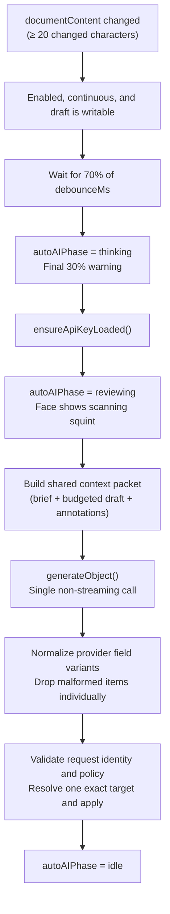

# AutoAI

AutoAI watches draft content and adds annotations after a configurable pause.
It runs independently of sidebar conversations and starts disabled. Its widget
controls automatic or manual review.

## Implementation

Files below live in `packages/desktop/src/lib/autoai`.

| File | Purpose |
|------|---------|
| [`settings.svelte.ts`](../packages/desktop/src/lib/autoai/settings.svelte.ts) | Settings store, localStorage persistence |
| [`engine.ts`](../packages/desktop/src/lib/autoai/engine.ts) | Review orchestration, AI calls, annotation dispatch |
| `reviewSchema.ts` | Provider-tolerant structured schema and strict result normalization |
| `outcome.ts` | Typed last-review result and compact user-facing labels |
| `AutoAIWidget.svelte` | Bubble + expanded panel UI |
| `AutoAIFace.svelte` | Animated face SVG component |
| `faceAnimation.svelte.ts` | Eye tracking + sleep/wake state |

## Settings

Stored in localStorage under `"quillium-autoai-settings"`:

| Setting | Type | Default | Description |
|---------|------|---------|-------------|
| `enabled` | boolean | `false` | Whether AutoAI is active |
| `mode` | `"continuous"` \| `"manual"` | `"continuous"` | Auto-review vs manual trigger |
| `debounceMs` | number | 10000 | Delay before review after change |
| `persona` | string | `"AutoAI"` | Name in annotation author fields |
| `annotationTypes` | array | comments only | Which types to create |
| `conservativeness` | enum | `"conservative"` | Review depth |

## Review engine

### Engine API

| Function | Purpose |
|----------|---------|
| `startAutoAI()` | Subscribe to `documentContent`, schedule reviews |
| `stopAutoAI()` | Unsubscribe, cancel pending timer |
| `cancelPendingReview()` | Clear the debounce without disabling the engine |
| `triggerManualReview()` | Cancel debounce, run immediately |

### Annotation application

Before review, AutoAI builds the same context packet used by the sidebar:

1. The writer brief and explicit saved editorial decisions are included as
   separate user-role guidance sources.
2. Long drafts are clipped to the AutoAI budget with an explicit omission marker.
3. Open annotations are included as editorial state so the model can avoid duplicates.
4. The model is instructed to annotate only exact substrings present in the
   included document text.

This keeps background review aligned with the visible sidebar context model and
prevents unbounded prompt growth on long drafts.

The generation schema intentionally accepts common provider field aliases.
`normalizeAutoAIReview()` converts each item to Quillium's strict comment,
suggestion, or revision shape and discards only malformed items rather than
rejecting an otherwise useful review.

For each normalized result:

1. Check that the request generation, document ID, tab ID, and draft ID still match.
2. Check that the annotation type is still enabled and allowed by the shared
   editorial policy.
3. Resolve `targetText` to one exact range in the live editor. Missing or repeated
   targets are rejected rather than applied to the first or every match.
4. Skip concerns that substantially repeat an active annotation on the same passage.
5. Dispatch through the shared editorial action gateway, which also rejects
   read-only editors.
6. If a suggestion or revision overlaps an existing one and comments are allowed,
   preserve the feedback as a comment and show a warning.

New edits abort an in-flight AutoAI request when a new review is scheduled. Every
content change also advances a generation counter, so even a small edit prevents
an older result from applying. Switching documents or drafts always schedules a
fresh review regardless of text similarity.

Each completed review publishes a document-local in-memory outcome. The expanded
widget reports whether the last review added notes, found no new concerns, skipped
duplicate or unsafe results, was discarded after the draft changed, or failed. The
outcome is cleared when the active document or draft changes. Routine cancellation
while the writer keeps typing is not presented as an error.

Read-only drafts cannot receive review annotations. Manual review runs
immediately for a non-empty draft. Its result distinguishes no concerns from
duplicate notes, rejected targets, and a draft changed during review.

## Widget state

The expanded widget exposes enablement, review mode, delay, annotation types,
review depth, and the last review outcome. `AutoAIFace.svelte` renders its visual
state. [`faceAnimation.svelte.ts`](../packages/desktop/src/lib/autoai/faceAnimation.svelte.ts)
owns caret and mouse tracking, sleep, and wake timing; the engine owns the
`idle`, `thinking`, and `reviewing` phases.

## Keybinding

`Mod-Shift-R` is registered in the main editor. It dispatches
`quillium:manual-review`, which `+page.svelte` handles with
`triggerManualReview()`.

## Shared behavior

AutoAI uses the sidebar's provider, credential loading, context packet, editorial
policy, annotation gateway, and provenance metadata. It registers an active AI
task and uses the shared abort signal. The global `stop-ai` event also cancels
pending debounce work. See [the AI pipeline](ai-sidebar.md).
