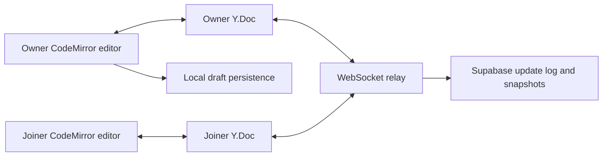

# Collaboration and Web Preview

Omni provides two ways to share writing:

- Web Preview publishes a read-only snapshot at a stable, document-keyed URL.
  The snapshot includes the selected draft from the current tab or all tabs.
- A Live Room mirrors one active draft between desktop editors through Yjs.
  The owner's SQLite draft remains authoritative. Joiners are ephemeral, and
  the session ends when the owner leaves.

Live Rooms use the **document ID** as their network room key. Each room mirrors
only the active draft when the owner starts it; sharing multiple tabs or drafts
at once remains future work. Owner snapshots and events stay attached to that
active draft. See the decisions on [owner-led rooms](adr/0008-owner-led-yjs-live-rooms.md)
and [document-keyed previews](adr/0010-document-keyed-web-preview.md).

## State ownership

The desktop implementation lives in
[`packages/desktop/src/lib/collab`](../packages/desktop/src/lib/collab/):

| Responsibility | Source |
|---|---|
| Start, join, and leave a session | `liveSession.svelte.ts` |
| Install and remove editor extensions | `index.ts` |
| Connection, authentication token, reconnects, owner-left signals | `yjsProvider.ts` |
| Text and annotation synchronization | `yjsBinding.ts`, `yjsAnnotations.ts`, `annotationSchema.ts` |
| Linked revision groups | `yjsVersionGroups.ts` |
| Relative positions, cursors, and following a collaborator | `relativePosition.ts`, `awareness.ts` |
| Session undo | `yjsUndo.ts` |
| Share dialog and preview publication | `GoLiveButton.svelte`, `readonlySharePublisher.svelte.ts` |
| Preview storage and wire payload | `shareRepository.ts`, `sharePayload.ts`, `shareState.ts` |

## Live Room lifecycle

When the owner starts a room, `LiveSessionController` queues a named snapshot,
**Before going live (auto)**, behind pending local edits. It registers the document
with Supabase, checks persistence again, and starts collaboration only if the
same editor, document, and draft are still active. A local persistence failure blocks this
transition. See [persistence](persistence.md) for the save-failure boundary.

After the provider synchronizes, the owner seeds the shared text, annotations,
and version groups from local state. The editor replaces CodeMirror history
with the Yjs extensions and a `Y.UndoManager`.

A joiner supplies the room ID. The controller captures the prior draft and
editor state, clears `currentDraftId`, and sets `isCollabJoiner` before connecting.
This prevents shared changes from entering the joiner's local event log. The
joiner's editor then loads the relay state.

`disableCollab()` removes the collaborative extensions and installs fresh,
empty CodeMirror history. Owners stay on their draft. Joiners restore their
captured state. The pre-session undo stack is not replayed across shared edits.

The provider retries a lost connection up to five times. Exhausting retries
ends the session and requires the user to start or join again. Owner departure
also ends the session, through a custom frame or the older close reason
`1000 / "Owner left"`. Either signal triggers teardown only once.

## Shared document model

A room's `Y.Doc` contains document text, annotations, and linked version groups.
Presence and cursor positions use Yjs awareness. Annotations are recursive
`Y.Map` nodes. Revision versions use stable IDs, an ordered ID array, and
`activeVersionId`.

[`annotationSchema.ts`](../packages/desktop/src/lib/collab/annotationSchema.ts)
owns conversion between CodeMirror annotations and Yjs nodes.
[`@quillium/share/collab-contract/annotations`](../packages/share/src/collab-contract/annotations.ts)
validates nodes before the desktop projects them into CodeMirror. Invalid nodes
are skipped individually. Owners and editors send opaque Yjs updates. The relay rejects every raw Yjs
mutation from viewers and commenters before application. Commenters instead send
validated create-comment and reply commands. The relay resolves root or nested
revision scopes and anchors, then creates the Yjs mutation itself. Viewer
permissions include reading, presence, and follow mode. Commenters cannot change
text, suggestions, revisions, existing messages, or comment status.

The relay records its schema version in `__quillium.schemaVersion`. Its v2
migration converts numeric revision-version keys and `activeVersionIndex` to
stable IDs. Desktop reads still accept the legacy form.

Local CodeMirror transactions update Yjs with the `"local"` origin. Remote Yjs
observers dispatch marked CodeMirror transactions so the change is not sent
back as a new local edit. Annotation anchors use relative Yjs positions so
concurrent text edits can move their ranges.

The same awareness extension runs in nested editors with position mappers
between nested and root coordinates. Cursors outside the nested range are not
rendered. Following a collaborator scrolls toward that user's cursor and stops
when the user disappears.

### Undo

`Y.UndoManager` tracks local edits to text, annotations, and version groups.
Nested editor text joins that scope through `addSubtreeToUndoScope()`.
`breakUndoCapture()` separates steps at modal boundaries. Owner bootstrap uses
the `"init"` origin, so initial room contents do not become an undo step.

## Relay boundary

[`@quillium/share/collab-contract`](../packages/share/src/collab-contract/index.ts)
owns handshake validation and custom frame encoding. The relay validates the
token and UUID before contacting Supabase, verifies the token, and checks room
access. A non-owner may join only while the registered owner is connected to
that relay process. Non-owners must also present a valid Live Room invitation. A document UUID
alone no longer grants access.

Custom frames use varuint type `3`, a varuint subtype, and a JSON string.
Subtype `1` signals owner departure with `{}`. Subtype `2` carries a departing
client's `{ userId }`. An empty type-3 frame retains y-websocket's awareness-query
behavior. Desktop ignores unknown or malformed custom payloads.

The relay creates one room per key, including concurrent initial connections.
It reads the snapshot and every update-log page before publishing the room.
A missing snapshot is valid; a failed read or invalid Yjs update rejects the
connection without migrating or rewriting partial state.

After the last client leaves, cleanup waits 45 seconds, drains updates, writes
a snapshot, and clears the log. New connections wait for in-progress cleanup.
If cleanup fails, the live document remains in memory and cleanup retries after
another delay.

Failed update batches remain ahead of newer updates. A new edit, explicit flush,
or cleanup retries them. Flushes include writes already in progress and reject
on failure. Shutdown stops new connections and incoming messages before flushing,
while outstanding room loads and socket closure finish. The process exits with
an error if flushing fails or shutdown exceeds 10 seconds.

These guarantees require one relay process. Retained failed batches exist only
in memory and can be lost on a forced exit. Deployment and configuration live
in the [relay README](../packages/relay/README.md).

## Live Room grants

`packages/relay/src/access/` owns invitation authorization and delivery. Grants
record the document, creator, role, invited email when present, creation and
update times, expiry, and revocation. The database stores only a SHA-256 hash of
each 32-byte random token. Web Preview `shares` rows remain separate.

Verified owners create, list, change, revoke, or replace invitations through the
relay's `/access/documents/:documentId/grants` endpoints. Direct authenticated
database writes are denied. Link replacement returns a new token and invalidates
the previous token. Existing hashes cannot recover a link, so the UI copies a
newly created link or offers **Replace link** for an older invitation.

`POST /access/invitations/resolve` accepts the token in its JSON body and requires
a Supabase session. Link grants accept anonymous sessions. Email grants require
a permanent account with a confirmed matching email. The endpoint reports invalid,
expired, revoked, wrong-account, and owner-offline states before the desktop
opens a WebSocket. Invitations expire after seven days by default, with an
upper limit of 90 days.

The relay rechecks access after room loading and rejects stale authorization
results using a room epoch and grant change counter. Role changes and revocation
mark affected connections inactive and remove them from outgoing broadcasts
before the HTTP response. They must join again with a fresh Y.Doc. Expiry is
checked on incoming messages and before sending updates, including when a timer
has not fired yet. These guarantees require the single relay process described
above. Changes through administrative database credentials outside this API are
not a supported live management path.

Comment commands carry a room epoch and request ID. Repeating the same command
within that room session applies it once. Reusing an ID with a different command,
using anchors in another text scope, or replying to a suggestion or revision is
rejected. Presence IDs belong to their sending connection and never authorize
access. Editors retain unrestricted document editing, so stored comment authorship
is not tamper-proof against editors.

### Local verification and activation prerequisites

Run `supabase start` with a disposable local project, then
`bun packages/relay/scripts/testAccessLocal.ts`. Set
`QUILLIUM_TEST_SUPABASE_WORKDIR` when the local project's configuration lives
outside the repository. The runner reads local credentials without printing them
and requires the grant and actual relay tests to run. It also runs the existing
relay convergence suite using invitation grants. The `Live Room access` PR
workflow runs these checks with local auth and database services.

Apply the appended grant migration and enable anonymous sign-ins when activating
this feature in an environment. Local `supabase/config.toml` enables anonymous
sign-ins for tests. No production provider setting is changed by repository
configuration. Email delivery requires `INVITATION_RESEND_API_KEY` and
`INVITATION_EMAIL_FROM` in the relay environment and a verified sender. Missing
transport or failed delivery reports failure and does not leave an active email
invitation. Tests use an in-memory email sink and simulated transport responses.

## Web Preview publication

The share dialog builds a versioned payload with serialized CodeMirror state
and flat annotations. `shareRepository.ts` registers ownership in
`sync_documents` and upserts the document's `shares` row. Republishing replaces
the snapshot while preserving the public token. Disabling a preview deletes
the share row.

`ReadonlyDocument` restores modern state through the shared read-only editor
host. Revision modals use the same host for nested `VersionState` values.
The flat projection supplies cards and navigation. Shared presentation and
desktop capability adapters follow the
[package boundary](monorepo.md#shared-editor-surface-architecture).

The landing RPC boundary validates metadata, recursive flat annotations, and
published state before rendering. Invalid payloads return the not-found page.
Early v2 envelopes without scope and pre-envelope states remain supported;
unknown editor-extension fields are preserved. A valid empty v2 tab list uses
the flat fallback.

`LegacyReadonlyDocument` handles shares without serialized state and valid
empty v2 tab lists. Keep that compatibility path until the prerequisites in
[issue #339](https://github.com/ThatXliner/Quillium/issues/339) are met.

## Configuration and limits

Desktop uses `PUBLIC_SUPABASE_URL` and `PUBLIC_SUPABASE_PUBLISHABLE_KEY` for
accounts and publishing. `PUBLIC_RELAY_URL` enables Live Rooms. The Share
button remains available with Supabase configured even when the relay URL is
empty. See [auth](auth.md) and the [environment examples](monorepo.md#environment-files).

Live Rooms have no durable joiner workspace, host migration, or offline queue.
Joiners open or paste an invitation link. Web Preview publishes one selected draft per
included tab, rather than every draft and run. For connected-service checks,
use the [cross-package E2E guide](../packages/e2e/README.md).
