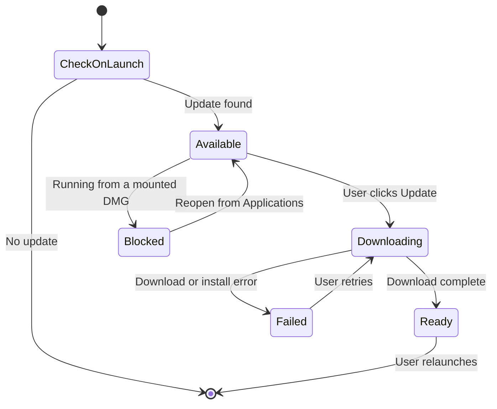

# Native integration

Tauri owns native menus, windows, credentials, updates, file dialogs, exports,
and the local MCP bridge. Native commands live in
[`packages/desktop/src-tauri/src`](../packages/desktop/src-tauri/src/). Browser
tests can mock the command bridge; verify database, keychain, and window behavior
in Tauri when those paths change.

## Local MCP server

The desktop executable also runs a local MCP server when a local AI client launches it with
`--mcp --data-dir <Quillium app data directory>`. AI Settings provides a copy-ready stdio
configuration with the installed executable and resolved data directory.

The server exposes these tools:

| Tool | Purpose |
|------|---------|
| `get_editor_context` | Read the running editor's active draft, unsaved text, selection, nested branch, annotations, brief and editorial preferences |
| `apply_editorial_action` | Add guarded comments, suggestions, revisions, raw dictation, or versions to that captured context |
| `read_editorial_workflow` | Read the dictation, nested revision, focused edit, readback, and retry playbooks |
| `list_documents` | List metadata for non-trashed local documents |
| `read_document` | Read saved Library index text, **not** the active draft |

For current writing, clients must call `get_editor_context` rather than infer the active draft
from Library sort order. Read again when the writer changes text or asks for an update. Context
is captured on demand, not cached on disk. The response distinguishes the active editing surface
(`text`, selection offsets, branch path) from the whole draft (`rootText`) and includes annotation
threads and revision alternatives. Context IDs expire after five minutes and after an action.

Pass `target: {documentId, tabId, draftId, revisionPath}` to read a specific version
without changing focus, opening a modal, or activating it. An empty path addresses
the root. Each path entry contains an editor-scoped `revisionId` and a stable
`versionId`. Explicit paths can address inactive versions. With no explicit target,
`surface` identifies the top open revision, comment, or suggestion-diff modal and reports the
entire modal stack. Revision modals register their actual editor independently of inline cards
and keyboard focus. A mounting modal returns an explicit loading error instead of falling back
to unrelated root text. `revisionPath` includes each ancestor's thread, surrounding prose, active
version ID and all alternative texts. Nested annotations remain available in serialized context,
including inactive versions. Comment/diff modal actions are scoped to their anchored passage.
Closing or changing a modal invalidates context captured from that modal. Explicit
paths stay independent of modal navigation. Two-level integration tests
exercise real nested controllers and verify that feedback propagates into root state and root undo.

Live calls require an open, loaded draft. A loopback listener with a per-launch random token
forwards requests to the last active editor window and accepts replies only from that window.
The endpoint file `mcp-live.json` lives beside the database (owner-only on Unix); it contains no
prose. Connections have timeouts and bounded messages. This is a local same-user integration,
not a sandbox against other programs running as the writer. No network-facing MCP endpoint is exposed.

The frontend uses `getActiveEditorialView` and `applyEditorialAction`, the same nested-editor
identity and CodeMirror command gateway as the sidebar. Context-bound actions reject changed prose,
drafts, branches, locked editors, ambiguous matches and targets outside the captured selection.
Suggestions and revisions preserve the writer's current prose. `insert_dictation`
inserts raw writer text into one outer version. `wrap_dictation` wraps existing
wording without duplicating it. Neither creates a blank Original. `add_version`
extends the named revision without activating the new version. These actions
return created identities for nested targeting and readback. A unique `requestId`
lets an identical write retry return its earlier receipt during the editor session.
Changed payloads with the same ID are rejected. Receipts are not persisted.

The same [editing playbooks](mcp-workflows.md) are compiled into
`read_editorial_workflow` and the optional `editorial_workflow` MCP prompt.
Tool descriptions carry essential rules and action-specific schemas for clients
that do not invoke either. Prompt support is advertised during initialization.
Prompts require explicit client invocation and do not guarantee workflow selection.
The server does not advertise MCP Skills extension support.

MCP clients do not write SQLite events or snapshots directly. CodeMirror commands
use the ordinary undo, persistence, provenance, and collaboration paths.
Conversations and model execution stay in the external AI client; scheduled AutoAI is unchanged.

After updating Quillium, restart the client's MCP connection to load the new tool definitions.

### Verify native editing workflows

Start the frontend with `bun run desktop:dev`, then run:

```bash
bun packages/desktop/scripts/evaluate-mcp-native.mjs --claude --codex
```

This macOS check builds the development MCP bridge with an isolated app identifier,
incognito WebView storage, and a temporary SQLite directory. It verifies actual
stdio writes, nested version targeting, mounted editor focus, undo and redo,
SQLite persistence, and a native restart. The optional model flags require the
corresponding CLI to be authenticated. Without those flags, it runs deterministic
native checks. The script prints the directory containing fixture-only tool
transcripts, assertions, and model outputs. Keep source files unchanged during
a run so development reloads do not invalidate focus checks.

## Native menus

`setup_app_menu()` in
[`lib.rs`](../packages/desktop/src-tauri/src/lib.rs) owns menu items and
accelerators. Custom items emit `menu:<id>` to the focused window, with `main`
as the fallback. The editor page handles writing actions; the library handles
**Open in New Window**. `+layout.svelte` handles **App Logs** on every route.
`settingsOpen` connects the native Settings item and in-app UI.

Selected prose has a native context menu with operating-system editing roles
and Quillium's Add Comment and Add Revision actions. Outside a selection, the
webview keeps its default context menu. See [keybindings](keybindings.md) for
shortcut behavior and the export section below for formats.

## Persistent app log

`app_log.rs` writes bounded JSONL to `quillium.log` in the same app-local data directory as
the database (or `QUILLIUM_DATA_DIR` in tests). The current file rotates at 2 MB and the
viewer reads both the rotated and current logs. **Help → App Logs…** works from every route
and can copy the log plus app version, platform, user agent, timestamp, and resolved path.

The log captures Rust panics, frontend console output, native menu events, startup version / OS /
architecture, and explicit operational events. Comment-shortcut diagnosis has two boundaries:

1. `comment-shortcut` proves Command-Shift-C reached the webview.
2. `comment-command` records the entry point and outcome without recording selected prose.

If boundary 1 is absent, the shortcut did not reach the webview. If boundary 1 appears without
boundary 2, event routing failed. Boundary 2 reports command blockers such as an empty selection,
a locked draft, or an already-open pending comment.

## Multiple windows

Each document window runs its own SvelteKit instance and editor stores.
`OpenWindows` in `lib.rs` maps document IDs to window labels. Opening an already
registered document focuses its existing window. New windows use an
`editor-<short_uuid>` label and load `/?doc=<id>`.

The native commands `cmd_open_in_new_window`, `cmd_register_open_doc`,
`cmd_deregister_open_doc`, and `cmd_is_doc_open_elsewhere` own that registry.
`Editor.svelte` registers loaded documents; window destruction removes their
entries. Library navigation flushes pending persistence before deregistering
and leaving. A failed flush keeps the current document open.

Both `default.json` and `desktop.json` capabilities include `main` and
`editor-*`. New native permissions must cover secondary windows too.
All windows share one `DbState(Mutex<Connection>)`, which serializes database
access. The registry prevents duplicate document windows during ordinary use;
it is not a cross-process database lock.

## Keychain

[`keychain.rs`](../packages/desktop/src-tauri/src/keychain.rs) stores API keys
through the OS credential store under `("com.bryanhu.quillium", provider_name)`.
`set_api_key`, `get_api_key`, and `delete_api_key` are the Tauri commands.
Provider secrets are separate from localStorage, where preferences and Supabase
sessions live. The frontend accesses credentials through the command bridge.

## Updates

The editor checks for updates on launch when the preference is enabled and
rate-limit backoff permits it. Direct desktop builds use
`@tauri-apps/plugin-updater`; Mac App Store actions open the store instead.
Mobile builds skip this desktop update path.

### Update flow



### States

| State | UI |
|-------|-----|
| Available | Banner with version + "Update" button |
| Downloading | "Downloading…" (disabled) |
| Blocked | Persistent instructions to move the app from the DMG to Applications |
| Failed | Persistent failure message + retry and manual-download options |
| Ready | Download complete, with a Relaunch button |

Uses `downloadAndInstall()` for reliable updates, `relaunch()` from `@tauri-apps/plugin-process`.
The orchestration in `updater/install.ts` checks the executable location before downloading,
classifies install failures, and returns explicit outcomes for the page to render and log.

The release workflow validates the final macOS updater archive after `tauri-action` completes. It
checks the embedded version, Apple code signature, Gatekeeper assessment, notarization ticket, and
Tauri Minisign signature. Public release publication is skipped if any validation fails.

Tags named `mas-vX.Y.Z-buildN` run only the signed Mac App Store build and upload it to App Store
Connect. Use that tag for TestFlight-only builds so the regular desktop updater and public release
remain unchanged. Keep the user-visible version in `tauri.conf.json`; increment the MAS-only
`bundle.macOS.bundleVersion` in `tauri.mas.conf.json` before every upload. macOS build numbers must
increase across all app versions.

### Check scheduling

[`updater/schedule.ts`](../packages/desktop/src/lib/updater/schedule.ts)
reads the stored next-check timestamp and response rate-limit headers. Failed
rate-limit parsing uses a one-hour backoff. Installation and error
classification live in
[`updater/install.ts`](../packages/desktop/src/lib/updater/install.ts).

## Document export

[`export.ts`](../packages/desktop/src/lib/export.ts) serializes the current
editor state and writes through a native save dialog:

| Format | Extension | Contents |
|--------|-----------|----------|
| Plain text | `.txt` | Document text only |
| Text + annotations | `.txt` | Text + JSON after `---` |
| JSON | `.json` | Structured object with title, timestamp, text, annotations |
| Markdown | `.md` | Text with annotations as footnotes |
| Word (Beta) | `.docx` | Selected revision text, without annotations |
| Word + Annotations (Beta) | `.docx` | Selected revision text and anchored comment threads |
| PDF | `.pdf` | Document body only |
| PDF + Annotations | `.pdf` | PDF with expanded annotation cards |

`exportDocument(view, format)` derives the filename from the title.
[`pdf_export.rs`](../packages/desktop/src-tauri/src/pdf_export.rs) renders PDF
paragraphs and nested annotation cards with wrapping and page breaks.

Word export uses `docxExport.ts` to walk the active draft and only the active
version of each revision. Its native comments carry Quillium comment threads,
revision conversations, and suggestion alternatives. Comments inside inactive
versions are omitted. The `docx` package creates the Word file in the frontend;
`cmd_export_bytes_with_dialog` saves the generated bytes. Word export is currently
offered on desktop only, like PDF export. Google Drive can convert the resulting
file to Google Docs, but comment preservation during conversion needs a live
Google Drive check before it can be promised.

## Changelog

The editor shows What's New after an upgrade to a new minor version. Patch
updates do not trigger it. The page compares `__APP_VERSION__` with the seen
minor version in localStorage and loads the matching `changelog.json` entry.
Settings also provides a manual What's New action. Follow the
[changelog guide](changelog.md) when adding entries or captures.
