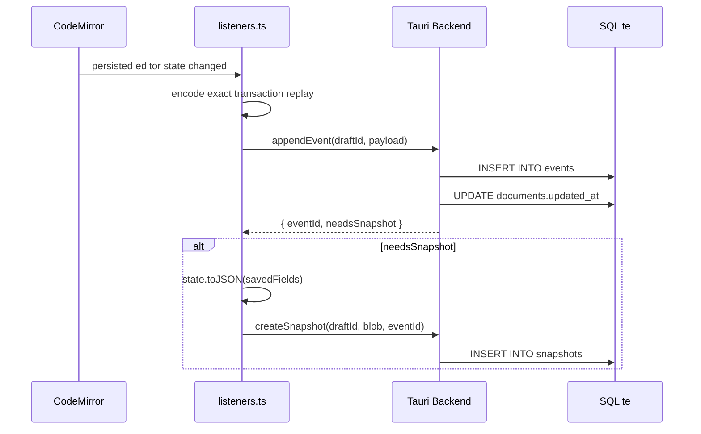

# Persistence

Quillium queues draft edits in an append-only SQLite event log and uses snapshots
to bound replay. SQLite runs in WAL mode. Database operations run in Rust through
Tauri commands. A queued edit is not durable until its write succeeds.

Architecture decisions: [event log and snapshots](./adr/0001-event-log-with-snapshots.md),
[lossless persisted undo](./adr/0006-lossless-persisted-undo.md).

## Schema overview

| Table | Purpose |
|-------|---------|
| `documents` | Document metadata (title, word count, preview, tags, undo-history policy, creator version) |
| `tabs` | Document tabs (label, position, type, soft-delete). See [tabs and drafts](./tabs-and-drafts.md) |
| `drafts` | Draft tree per tab (`tab_id`, `parent_draft_id`, `locked`, soft-delete) |
| `doc_events` | Document-level structural audit log (tab CRUD, branching, locks, checkpoints) |
| `events` | Append-only log of CM transactions (draft-scoped) |
| `snapshots` | Full `EditorState.toJSON()` blobs (draft-scoped) |
| `ai_conversations` | Legacy draft/mode message arrays, preserved during migration |
| `ai_conversation_history` | Distinct conversations, archive state, source draft and branch origin, message JSON |
| `document_ai_profiles` | Document-scoped writer brief |
| `document_editorial_decisions` | Writer-confirmed document-scoped decision JSON |
| `_meta` | Key/value flags (`active_tab:{doc}`, `active_draft:{tab}`) |

The `documents` table has no `state_json` column. A draft is reconstructed from
its snapshot and later events.

## Schema migrations

The schema is built and evolved by a versioned migration runner in
`packages/desktop/src-tauri/src/db/migrations.rs`, keyed on `PRAGMA user_version`. `open_db()`
(`schema.rs`) opens the connection, sets WAL/foreign-key pragmas, then calls
`migrate()`, which applies every migration newer than the DB's recorded
version. Each runs in its own transaction, so a failed migration leaves the DB at
the previous version. A migration is either plain SQL or a Rust function (for
backfills and conditional DDL).

To change the schema, append a new numbered `Migration`. Never edit a
shipped migration, since deployed DBs have already recorded its version as applied.
Migration #1 is the baseline; pre-framework databases report `user_version = 0`
but already have the baseline tables, so early migrations are written to be
safe to re-apply (`IF NOT EXISTS` / column-existence guards).

The migration definitions in
[migrations.rs](../packages/desktop/src-tauri/src/db/migrations.rs) are the
authoritative schema history.

## Document creator provenance

`documents.created_with_version` records the exact version from the Tauri app's
runtime package metadata when a new document is created. The value follows the
configured Quillium version string, including SemVer prerelease and build
metadata such as `0.24.4-dev.7+sha.abc123`. Development builds keep the
configured runtime value as-is; the database does not invent a separate dev
label or infer a suffix from the frontend build.

The column is nullable. Documents created before migration 12, and imported
metadata whose creator version is unavailable, remain `NULL` because their
provenance is unknown. Duplication copies the source document's value,
including `NULL`, so creating a new database row does not replace its original
creator provenance. There is no full document importer today. Any future
importer must pass the original creator version to the database insertion
helper, or `NULL` if it is absent. The Rust tests cover this metadata
deserialization and insertion boundary. There is no `imported_with_version` or
`last_migrated_with_version` column yet because no operation needs that
separate history.

Migrations 8 and 9 still use the documented creation-time boundary for undo
history because that policy predates creator-version metadata. Retiring that
temporary cutoff is tracked separately in [issue #344](https://github.com/ThatXliner/Quillium/issues/344).

## Event log flow

The persisted fields are declared in
[extensions.ts](../packages/desktop/src/lib/editor/extensions.ts). They include
annotations, version groups, and the persistent-history adapter. That adapter
serializes session-only history as `null`.

Snapshot triggers include:

- At least 50 events since the last snapshot
- At least 120 seconds since the last snapshot, checked on the next event append
- About 30 seconds without a persisted editor change
- Leaving the editor or switching drafts with edits not yet captured by a snapshot
- Backgrounding the app, hiding the webview, or closing its native window
- Opening a draft with a successfully replayed event tail from the previous session

`flushPersistence()` queues a checkpoint behind pending event writes and awaits
it before flushing metadata. Idle checkpoints use the same ordered queue. The checkpoint
retains the immutable state and draft/event
IDs from the successful append; repeated flushes do not duplicate it. A failed checkpoint
blocks the transition and can be retried. An event append failure remains attached to
that loaded draft. Both flush APIs reject, navigation stays in the editor, and later
appends cannot clear the error or create snapshots over the uncertain event history.
The editor keeps the current text in memory. Before a forced reload or restart,
copy the current writing somewhere safe. Reloading cannot recover an event that
never reached SQLite. Appends are not retried or reconciled automatically because
an error may occur after SQLite has already inserted the event. Loading a new
draft seeds separate bookkeeping so late completions cannot change its save status.
Each loaded draft also retains its own event cursor for queued snapshots. Going live,
manual checkpoints, and crash snapshots capture the editor state synchronously and
queue it after its pending edits. Failed event history blocks those snapshots and
content metadata updates. Crash handlers still preserve the plain-text localStorage
backup when a snapshot cannot be saved.

Document metadata has separate title, tags, and content operations. Each updates only
its owned fields. Content writes refresh word count, preview, and the search body, and
request semantic indexing. They may propose an automatic title, which SQLite applies
only while the stored title is still `Untitled`. Renaming and tagging preserve content
and its search index.

Native window close waits for persistence and remains open if saving fails. Focus loss
and visibility changes start a best-effort flush because the OS does not wait before
backgrounding. Force quit, process termination, and the native app Quit menu do not
provide this awaitable window-close barrier; successfully appended events remain the
recovery source. Repeated lifecycle notifications do not duplicate an unchanged snapshot.

## Load flow

[load.rs](../packages/desktop/src-tauri/src/db/load.rs) loads the latest snapshot
and all events after its `up_to_event_id`. The frontend restores the snapshot,
then replays the tail through
[replay.ts](../packages/desktop/src/lib/editor/replay.ts). On a complete reconstruction,
the loader queues a checkpoint when that tail is nonempty. Invalid snapshots and
failed event replay do not become automatic session-start checkpoints. A failed
recovery checkpoint stays pending for a later flush.

New event payloads carry a versioned `transactionReplay` trace. It preserves each accepted
CodeMirror transaction boundary, `ChangeSet`, start/final selection, tagged annotation/version-group
effects, history annotations, and undo/redo intent. Replay therefore rebuilds the exact document and
semantic state instead of approximating a transaction from the older aggregate event fields.
Selection-only cursor movement is not logged by itself; the next persisted transaction records the
surviving selection contribution on the current history item and whether it split the live undo
group. That avoids cursor-event log churn while preserving both grouping and the cursor restored by
later undo/redo. Undo and redo are replayed against the restored branch when cross-restart history is
enabled; the payload also contains the exact accepted transaction as a fallback when that branch is
absent.

Legacy events without a trace still restore their content through the older payload fields, but are
applied with `addToHistory: false`. They must not manufacture an undo stack whose annotation effects
were never recorded. If a persistent snapshot is followed by a legacy, fallback, or failed replay
event, reconstruction also clears that snapshot's branch because it can no longer prove the branch
describes the final semantic state.

Live collaboration temporarily removes CodeMirror history and uses `Y.UndoManager`. Exact traces
record that boundary as `historyRuntimeDisabled`; crash recovery then rejects any pre-collaboration
CodeMirror branch, applies the rest of the tail without manufacturing history, and starts the reopened
document with a fresh stack.

## Event payload format

| Type | Shape |
|------|-------|
| `doc_change` | `{ changes: [{from, to, insert}], selection }` |
| `annotation_add` | Full annotation object |
| `annotation_remove` | Annotation ID |
| `annotation_update` | Full annotation object (diff detected) |
| `compound` | Doc change + annotation effects together |
| `state_transaction` | Effect-only persisted-state change, such as version-group membership |

Every new payload can include:

- `transactionReplay`: the versioned exact transaction trace described above
- `stateFallback`: full document, annotation, and version-group state when the
  exact trace is unavailable or fails verification

The listener verifies a trace by replaying it against the transaction's starting state and comparing
the resulting document, annotation map, and version-group map before the event enters the log. A
failed verification records `stateFallback` instead of accepting a partial codec.

## Snapshot pruning

Automatic pruning on app startup: if retention policy is configured via `setSnapshotRetention`, all unlabeled snapshots older than N days are pruned. Named snapshots (non-null `label`) are never auto-pruned.

Manual pruning via Version History:

- `pruneSnapshotsKeepLastN(draftId, n)`
- `pruneSnapshotsOlderThan(draftId, days)`

## Durability boundaries

Text and semantic annotation changes enter the same ordered, asynchronous queue.
Typing does not wait for the preceding write. Nested edits reach that queue through
parent transactions. Effect-only changes, including version-group membership,
are persisted even when the draft text does not change.

`flushPersistQueue()` waits for the writes queued when it was called.
`flushPersistence()` also checkpoints unsnapshotted edits and flushes metadata.
Navigation uses the latter. Neither API treats a later successful write as proof
that an earlier failed append is safe.

Snapshots bound replay cost; they are not the normal durability boundary.
[Crash recovery](error-handling.md) adds best-effort recovery copies, which do not
replace a successful database write.

## Undo history policy (0.22+)

`documents.persist_history` captures the undo policy when a document is created. Migrations 8 and 9 use
`2026-07-14T00:00:00Z` as a temporary release-version proxy: documents created before that boundary
become persistent, while documents at or after it keep the session-only database default. The
separate migration 9 also covers documents created while pre-release builds already had the policy
column. New documents explicitly use the current **Settings → Editor → Undo after restart for new
documents** preference, whose default is off. Changing the preference affects future documents only;
it does not silently rewrite an existing document's policy.

Session-only documents still use normal undo and redo while they are open. Their snapshots serialize
`historyField` as `null`, and exact event-tail replay applies changes without adding them to a new
history branch, so reopening starts with a clean stack while preserving all content and annotations.

Persistent documents use `persistentHistoryField`, which stores CodeMirror's changes and selections
alongside tagged Quillium effects. Pre-0.22 CodeMirror history JSON omitted those effects and could
undo text without restoring its annotations or revisions. The adapter rejects that legacy shape and
clears the unsafe stack on the document's first post-upgrade load. This is a one-time reset: the next
snapshot uses the lossless format, and subsequent restarts preserve the rebuilt history. Unknown or
malformed future history data also fails closed to a fresh stack rather than loading partially.

## Revision version persistence

`extractAnnotationEvents` writes `addAnnotation`, `removeAnnotation`, and `updateThread` as explicit events. Internal revision effects (`_updateRevisionVersionState`, `_addVersionToRevision`, etc.) are captured by a pre/post diff on `annotationField`: any annotation whose identity changed gets an `annotation_update` event. The exact transaction trace is authoritative for new events; these explicit event shapes remain useful for compatibility, provenance, and replaying older logs.

Nested-editor flushes write back through `updateRevisionVersionState`, making the parent `annotationField` the source of truth. The normal persistence path observes the parent transaction.

## Storage APIs and related state

[db/index.ts](../packages/desktop/src/lib/db/index.ts) defines the TypeScript
wrappers and Tauri command names. Callers outside the persistence listener create
active-editor checkpoints through
`persistNamedVersion()` in
[listeners.ts](../packages/desktop/src/lib/editor/listeners.ts), which pairs the
captured state with that loaded draft's event cursor after its pending writes.
Calling `createNamedSnapshot()` directly from those callers bypasses that ordering.
The listener also writes recovery snapshots internally while processing its queue.

Other persisted state has separate owners:

- [AI conversations](ai-sidebar.md#conversation-identity-and-alternative-paths)
  use distinct conversation IDs. Legacy draft-mode arrays remain readable for
  compatibility. Conversation history retains its draft association after draft
  deletion and cascades with its document.
- Writer briefs and confirmed editorial decisions belong to the document and
  are copied when it is duplicated.
- [College applications](college-applications.md) store document activation and
  versioned tab setups separately. Batch tab creation validates and commits the
  whole batch atomically. Duplication maps setups to the new tab IDs; soft deletion
  retains them.
