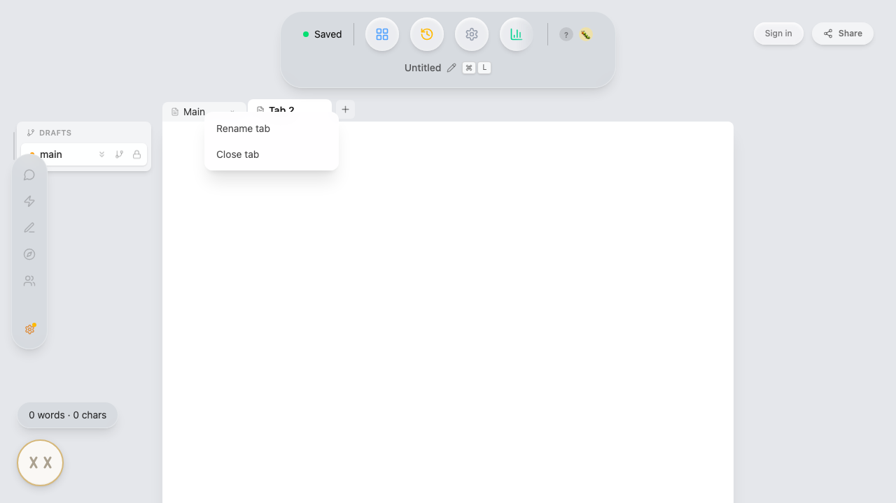

# Document tabs and draft trees

A document contains tabs. Each draft tab contains drafts related by iteration
and branching. An iteration continues a run; a branch starts an alternate run.

Architecture decisions: [iteration and alternate-run lineage](./adr/0002-separate-iteration-and-branch-lineage.md),
[activity and content history](./adr/0003-separate-activity-from-content-history.md),
[Web Preview identity](./adr/0010-document-keyed-web-preview.md).

```
Document (one card in Library)
└── Tabs (top bar, horizontal)
    ├── Draft Tab "Main"
    │   main → v1 → v2          ← iteration run (flat)
    │            └ take 2 → …    ← branch off v1 (indented), its own run
    └── Draft Tab "Notes"
        main
```

## Iteration and branching

Each draft uses at most one of two links:

- `parent_draft_id` records iteration within a run. The run renders flat, oldest
  first. Iterating locks superseded drafts and leaves the new head editable.
- `branched_from` starts an alternate run. It renders one level below its source
  and does not lock the source. Any live draft can be a branch source, including
  a locked draft or another branch's root.

The first draft in the initial run has neither link. The
[domain glossary](../CONTEXT.md) owns the definitions of document, tab, draft,
run, branch, and lock.

## Tab actions

Right-click a tab, or focus it and press Shift+F10 or the context-menu key, to
open Rename tab and Close tab. Opening the menu leaves the active tab unchanged.
Rename focuses the existing inline editor. Close uses the same soft-delete,
Undo toast, and history restoration as the tab's × button; the final tab cannot
be closed. Read-only tab bars omit the menu. Duplicate is omitted because there
is no tab-level operation that copies a complete draft tree.

Use arrow keys or Home/End within the menu. Escape or Tab dismisses it and returns
focus to the originating tab; outside interaction also dismisses it.



## Schema

```sql
tabs       (id, document_id, tab_type, label, position, created_at, deleted_at)
drafts     (id, document_id, tab_id, parent_draft_id, branched_from, label,
            created_at, is_active, locked, deleted_at)
doc_events (id, document_id, event_type, payload, created_at)
```

A draft sets at most one of `parent_draft_id` (iteration) / `branched_from`
(branch). The storyline root (`main`) sets neither; branch roots set
`branched_from` and no `parent_draft_id`.

Events and snapshots are draft-scoped. Every draft has an
independent event log and version history. `_meta` keys `active_tab:{doc_id}`
and `active_draft:{tab_id}` persist the user's position.

Tab and draft deletion is a soft delete through `deleted_at`. Their rows, events,
and snapshots remain available while the document exists. Permanently deleting
or purging the document removes its stored content. Tab and draft deletion offers
an Undo toast and session keyboard undo. The history timeline can restore those
soft-deleted rows later.
Structural operations append `doc_events` rows for the document-wide timeline.

The [migration definitions](../packages/desktop/src-tauri/src/db/migrations.rs)
include upgrades that attach pre-tab drafts to a Main tab and translate older
fork links into `branched_from`. See [persistence](persistence.md#schema-migrations)
for the migration rules.

## Iterate and branch

`cmd_iterate_draft(source_draft_id, label, state_json)` and
`cmd_branch_draft(source_draft_id, label, state_json)` both:

1. Take the source's current state, serialized by the frontend. This uses the live
   `EditorView` if the source is open, otherwise rebuilt from a snapshot
   and event replay through `seedStateJson()` and `buildStateFromLoad()`.
2. Create the new draft and plant that state as a snapshot labeled
   **"Branch point"** (`up_to_event_id = -1`). Labeled snapshots are exempt
   from snapshot pruning. The new draft's event log starts empty. History previews use the seed before the first
   later snapshot; internal branch-point seeds are hidden from the timeline.

They differ only in the link and the lock side effect:

- **iterate** sets `parent_draft_id = source` and relocks the run so only the
  new head is editable (the source, now superseded, locks).
- **branch** sets `branched_from = source` and locks nothing. Any live draft
  can be the source, including the storyline root (`main`) and branch roots.

## Deleting drafts

Any unlocked draft that is not the tab's last live draft can be deleted,
including a parent. Locked rows hide the delete action. The three paths are:

- For a leaf, `cmd_delete_draft(draft_id)` soft-deletes the one draft (refused
  only if it's the tab's last live draft).
- For a parent with **Keep the children**, `cmd_orphan_and_delete_draft(draft_id)`
  reattaches every live child so the tree stays valid, then soft-deletes the draft. An iteration child splices
  the draft out of the run (adopts its `parent_draft_id`); a branch child
  re-points to the draft's anchor. When deleting a branch root, its iteration
  children become branch roots off the deleted root's original source. It
  returns the list of link rewrites so Undo can reverse them via
  `cmd_reparent_draft` (after the parent is restored). Logs
  `draft_deleted {mode: "orphan"}` + one `draft_reparented` per moved child.
- For a parent with **Delete all N**, `cmd_cascade_delete_draft(draft_id)`
  soft-deletes the draft and its whole subtree (iterations + branches, transitively) in one transaction; refused
  if that would empty the tab. Returns the deleted ids so one Undo restores
  the lot. Logs `draft_deleted {mode: "cascade", ids}`.

The orphan/cascade choice is a modal (`DraftDeleteModal.svelte`); a childless
draft skips it. The editor switches off any draft about to vanish first, so it
never points at a hidden draft (for cascade, it lands on a draft *outside* the
deleted subtree).

### Keyboard undo and redo

`Cmd/Ctrl-Z` restores the most recent draft or tab deletion, including cascade and
orphan operations. `Cmd-Shift-Z`, `Ctrl-Shift-Z`, and `Cmd/Ctrl-Y` redo it. The Undo toast consumes the same
entry, so it cannot restore an already-undone deletion twice. The current surviving
draft stays selected; structural undo also works when that draft is locked. Only
the latest deletion toast is kept, so older restores cannot bypass deletion order.
Undo dismisses that action and briefly names the restored item. Redo offers Undo again.

Newer content edits undo before the deletion. Switching drafts starts a new boundary
against the selected draft's content history. Relocking a parent during restore
preserves its text undo and redo. A locked survivor restores the deletion while
leaving inaccessible prose unchanged. Additional structural gestures are declined until the
current operation finishes. Text inputs retain native undo, and
Live Rooms retain Yjs keyboard undo. Deletion entries last for the open editor session;
after leaving it or changing documents, use Version History to restore deletions.
See [the session undo decision](adr/0012-session-undo-for-deletions.md).

## Locking

A draft is locked when either is true:

- A superseded draft has a newer live iteration in its run. `relock_run`
  re-derives this on every iterate/delete/restore: each run locks all live
  members except the head. Runs are independent, so each alternate run has its
  own editable head.
- A manual lock is set from the row in the panel. Recalculating a run after
  deletion or restoration clears a manual lock if that draft becomes the head.
  The writer can lock it again from the panel.

While locked, the editor state is built with `EditorState.readOnly.of(true)`.
An amber strip inside the page reads "This is an older version." (superseded)
or "This draft is locked." (manual), and offers "Edit anyway" (persistent
unlock) plus "New take" (branch from the locked draft into an editable run).

**Annotation creation is refused on locked drafts**: the comment/revision
keyboard commands and the programmatic `createComment`/`createSuggestion`/
`createRevision` entry points (used by the AI sidebar and AutoAI) all bail on
`state.readOnly`, and the AutoAI engine skips reviewing read-only drafts
entirely. Event replay dispatches raw effects, so loading locked drafts is
unaffected. The database does not enforce the editor lock on event writes; replay and
collaboration use their existing write paths.

## Resolution order

Opening a document without an explicit draft id resolves:
active tab (`_meta`) → first tab by position → that tab's active draft
(`_meta`) → first draft by `created_at` → legacy pre-tabs fallbacks.
This logic lives in Rust (`load.rs → resolve_default_draft`) and is mirrored
for the frontend by `resolveActiveDraftId()` in `packages/desktop/src/lib/db/index.ts`
(used by export, the library preview, and version-history bootstrap).

## Structural invariants

Every live document must keep a live tab, and every live tab must keep a live
draft. Creation seeds the initial rows. Deletion rejects operations that would
empty either container. Locks are enforced by the editing commands, while
supersession is recalculated when run membership changes.

## Key files

| File | Role |
|------|------|
| `packages/desktop/src-tauri/src/db/tabs.rs` | Tab CRUD, iterate/branch, run relocking, active pointers |
| `packages/desktop/src-tauri/src/db/migrations.rs` | Numbered schema migrations (#6 tabs, #7 branch relation) |
| `packages/desktop/src-tauri/src/db/load.rs` | Tab-aware default draft resolution |
| `packages/desktop/src/lib/editor/DocumentTabs.svelte` | Browser-style tab bar |
| `packages/desktop/src/lib/editor/tabReorder.ts` | Pure reorder math for tab drag-and-drop |
| `packages/desktop/src/lib/editor/DraftTreePanel.svelte` | Draft panel (flat runs, indented branches) |
| `packages/desktop/src/lib/editor/DraftDeleteModal.svelte` | Orphan-vs-cascade prompt for deleting a draft with children |
| `packages/desktop/src/lib/editor/draftTree.ts` | Pure helpers (`layoutDraftRows`, `isDeletableDraft`, `hasLiveChildren`, `collectSubtree`) |
| `packages/desktop/src/lib/editor/Editor.svelte` | CodeMirror view lifecycle, store mirrors, lock banner |
| `packages/desktop/src/lib/editor/documentLoader.ts` | Bootstrap, load cancellation, draft commit ordering, state seeding |
| `packages/desktop/src/lib/editor/tabDrafts.svelte.ts` | Tab/draft selection, iterate/branch/delete, tab tree state |

## Omni Web Preview identity

The read-only Web Preview is keyed by **document id**, not draft id, so one
public link follows the document. Its versioned payload can publish the current
draft tab or all draft tabs, with the selected draft state for each included
tab. Publishing from another tab or run replaces the document snapshot without
changing the link. Live Rooms remain a separate mechanism and currently key on
the active draft; #260 tracks bringing them in line with the tabs/drafts model.

## Current scope

Live Rooms work on the active draft; they do not synchronize the document's whole
tab and draft structure. Web Preview can include multiple tabs but still chooses
one draft per tab. Content checkpoints remain draft-scoped. Canvas tabs and a
workflow to merge draft branches are not implemented.

## Loading the root editor

`DocumentLoader` starts its document subscription on mount. Bootstrap chooses the
requested document, the most recently updated document, or creates an initial
document. The page supplies the first-visit decision used for both the tutorial
and sample content. Sample content is snapshotted before the document ID becomes
visible to subscribers.

Document and draft loads return one `LoadedDocument` and share a cancellation
counter. Pending persistence finishes before reads. A failed flush leaves the loaded
draft active and restores the committed selection; it must not commit a new
active pointer or release the current editor. A successful commit seeds the
draft identity and latest event ID, then asks `Editor.svelte` to install the state
and refresh its Svelte mirrors. Stale reads cannot commit. Once a draft-pointer
write is queued, its same-tab state commit finishes even if a newer load starts;
this keeps the editor aligned with the last successful write if the newer load
fails. Unmount cancels pending loads and tab refreshes.

Iterations and branches seed from the live state when their source is open,
otherwise from snapshot and event replay. Both paths preserve the document's undo
policy; reconstructed seeds omit the source draft's lock.
